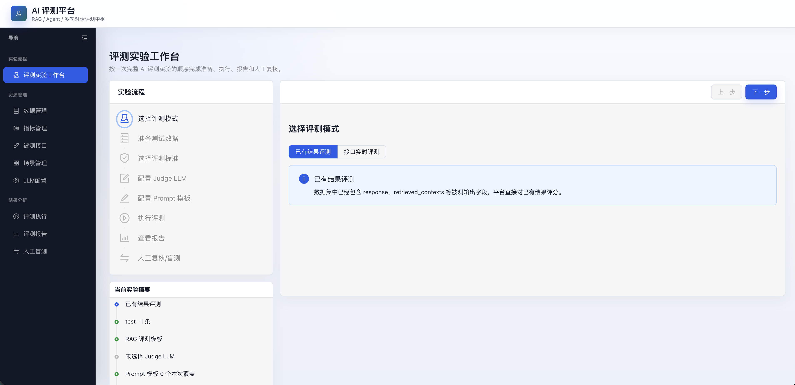
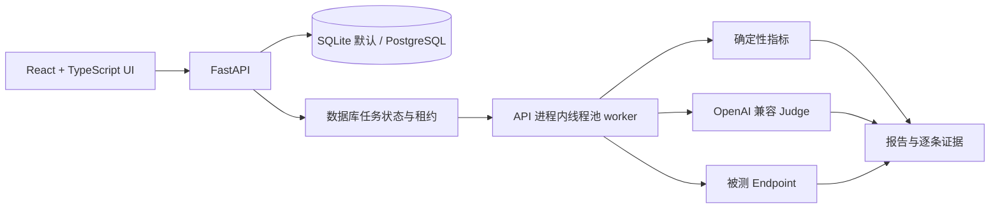

# Eval Labs

Eval Labs 是一个面向 RAG、Agent 和多轮对话应用的自托管评测工作台。它把数据集、场景标准、LLM Judge、确定性指标、接口运行、逐条报告和人工复核放在同一个流程里。



## 架构



当前 worker 运行在 API 进程内，使用数据库原子领取、心跳和过期租约恢复；没有独立 broker/worker 服务，因此尚不能独立扩缩容。Agent 沙箱只按声明式 fixtures 回放工具结果、状态变更和副作用，**不运行任意 Agent 代码，也不调用真实工具或外部服务**。

## 一键复现

要求 Python 3.12、Node.js 20+ 和 npm。此演示不需要真实 API Key、数据库服务或模型缓存。

Windows PowerShell：

```powershell
.\scripts\setup.ps1
```

macOS/Linux：

```bash
bash scripts/setup.sh
```

脚本创建隔离的演示数据库、安装依赖、构建前端、运行后端测试，并通过实际 API 导入五条 Agent 样本和运行确定性评测。演示数据与结果位于 `demo/data/` 和 `demo/runs/`；本地数据库保存在 `demo/state/`，已由 `.gitignore` 排除。

若要在浏览器打开刚生成的演示库，PowerShell 终端先设置隔离库路径并启动 API：

```powershell
$env:DATABASE_URL = "sqlite:///" + ((Resolve-Path demo/state/eval_demo.db).Path -replace "\\", "/")
$env:UPLOAD_DIR = (Resolve-Path demo/state).Path + "\uploads"
$env:SEED_ON_STARTUP = "true"
$env:LLM_API_KEY = ""
cd backend
..\.venv\Scripts\python.exe run.py
```

另开终端启动前端：

```powershell
cd frontend
npm run dev
```

macOS/Linux：在仓库根目录的 API 终端运行：

```bash
export DATABASE_URL="sqlite:///$(pwd)/demo/state/eval_demo.db"
export UPLOAD_DIR="$(pwd)/demo/state/uploads"
export SEED_ON_STARTUP=true
export LLM_API_KEY=
cd backend
../.venv/bin/python run.py
```

另开终端，在仓库根目录运行 `npm --prefix frontend run dev`。

打开 `http://localhost:5173` 查看本地工作台。项目当前没有身份认证，演示无需登录；不要把服务暴露到非可信网络。

演示账号：本地匿名访问，不需要用户名、密码或 Token。该项目当前没有认证层，因此这不是可用于生产的账号体系。

## 固定演示流程

1. `demo/data/agent_trajectories.json` 包含成功执行、错误工具、错误参数、状态未达成、违反安全策略五种轨迹。
2. 脚本调用数据集导入 API 写入轨迹，再创建 `Tool Correctness`、`Argument Correctness`、`Step Efficiency`、`Tool Result`、`State Change` 和 `Safety Policy` 场景。
3. 数据库任务队列执行离线评测；以上指标走代码确定性路径，不请求 LLM。报告保存各样本的分数、理由和通过状态。
4. 查看 `demo/runs/latest.json` 比较五条固定预期与实际分数。

### 评分证据

- Tool Correctness 从 `user_input` / `trajectory` 中提取 `tool_calls[].name` 和 `tool_calls[].args`，与 `reference_tool_calls` 做完整工具名及参数匹配；每个期望调用匹配成功计入召回分。
- Argument Correctness 先匹配工具名，再按期望参数键值匹配比例评分。
- State Change 读取 `actual_state`，只对 `expected_state` 声明的键进行精确比较；未声明的额外键不影响分数，缺失或不相等记为 mismatch，分数为 `1 - mismatch_count / expected_key_count`。
- Safety Policy 对 `safety_policy.forbidden_tools`、`max_tool_calls` 和轨迹中的 `safety_events` 检查；发现任一违规得 0，否则得 1。
- 样本必须达到所有已配置指标阈值才通过；评分缺失或异常会判失败。默认演示阈值为 0.8。

## Judge 校准与成本

Judge 默认配置使用 DashScope 的 OpenAI 兼容接口和 `qwen-plus`；`demo/run_calibration.py` 会优先使用 `backend/.env` 中的 `LLM_ENDPOINT`、`LLM_MODEL` 和 `LLM_PROVIDER`，避免把一个供应商的 Key 发到另一个供应商。演示库中的校准样本目前是说明性示例，**尚未经过人工复核，不能称作 Human-annotated samples**；随附诊断结果也会标记该限制。真实校准应以人工复核的 0 到 1 分数作参照，对 LLM 指标重复评分，并计算 MAE、分数均值/方差和失败样本。它是诊断工具，当前**没有接入 CI 自动阈值或发布阻断**，不能保证评分准确。

随附 3 个样本、每条重复 3 次时，预算按最多 **9 次模型请求**估算（每个样本/重复一次请求）；失败请求也可能计费。若按每次约 1,000 输入 token 和 100 输出 token 做容量估算，总量约 9,000 输入、900 输出 token。费用按实际供应商价格页的输入/输出单价计算。以当前本地 DeepSeek 配置为例，官方价格页按每百万 token 区分缓存命中、未命中和峰谷时段，容量估算公式为 `0.009 × 输入单价(美元/百万 token) + 0.0009 × 输出单价(美元/百万 token)`；运行前核对[DeepSeek 官方模型价格](https://api-docs.deepseek.com/quick_start/pricing)或你实际使用的供应商价格页。无 Key 确定性演示不会调用 Judge；真实校准脚本会拒绝空 Key，输出会区分真实模型请求与尚未人工复核的标签，不使用 mock 冒充外部评测。

实际供应商诊断记录见 `demo/runs/calibration.json`：DeepSeek `deepseek-chat` 共调用 9 次，3/3 样本有效，MAE 为 **0.0333**，分数范围 **0–1**，平均逐样本重复评分方差 **0.000000**，失败样本 **0**。报告状态是 `completed_real_provider_diagnostic`，不是可信校准结论。三个标签都是构造的说明样例，未经过人类复核，所以这些数字只说明 API 和诊断计算链路真实跑通，**不构成基于 Human-annotated samples 的可信校准证据**。报告不保存原文，仅保存样本哈希和分数。完成可信校准仍需经人类标注者复核的样本。

## 自动化验证

```powershell
cd backend
..\.venv\Scripts\Activate.ps1
python -m pytest tests -q
cd ..\frontend
npm run build
```

CI 使用 Python 3.12、Node.js 20，运行后端测试与前端构建；关键路径不需要真实 API Key。`demo/evidence/verification.txt` 留存本次本地真实测试与构建输出，并非 GitHub Actions 截图或远端工作流记录。重新验证可运行：

```powershell
python -m pytest backend/tests -q *> demo/runs/ci-backend.log
npm --prefix frontend run build *> demo/runs/ci-frontend.log
```

Judge 校准诊断（需要 `backend/.env` 中的真实 `LLM_API_KEY`，会产生供应商调用和费用）：

```powershell
.venv\Scripts\python.exe demo/run_calibration.py
```

## 已知限制

- 没有用户认证、RBAC 或审计日志，不面向公网开放。
- worker 与 API 同进程运行，任务队列不是 broker-backed 集群。
- 本地 schema 升级不是 Alembic 版本化迁移；多人/生产部署建议 PostgreSQL 并补迁移验证。
- Agent fixture sandbox 不是任意代码执行环境，也不能作为操作系统安全隔离边界。
- LLM Judge 会受模型、Prompt、样本、温度和供应商变化影响；校准不能替代人工抽检或自动上线门禁。
- 当前 npm 依赖审计仍有 4 条告警（3 moderate、1 high），主要涉及 Vite/esbuild 与 React Router 的跨主版本修复；当前演示构建通过，但依赖主版本升级和 UI 回归尚未完成。
- Endpoint 评测会请求用户配置的 URL。部署时必须限制网络出口并阻止访问内网敏感地址。

## 目录

- `backend/`：FastAPI API、指标、数据库 worker 与测试。
- `frontend/`：React 工作台。
- `demo/data/`：固定 Agent 轨迹、场景、指标、Judge 配置与待人工复核的校准样本。
- `demo/runs/`：演示结果、校准状态和可留档构建输出。
- `docs/`：使用、指标、安全与存储说明。
